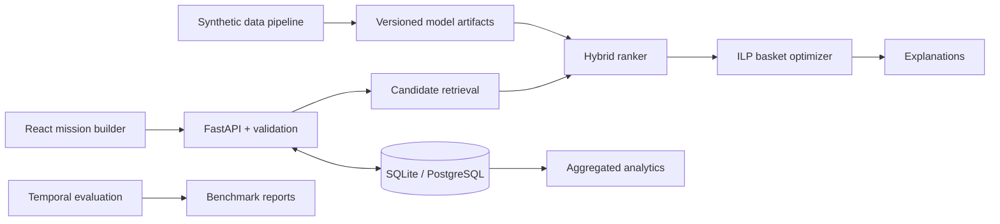

# RASA — Relevance-Aware Shopping Assistant

RASA adalah sistem rekomendasi produk berbasis **misi belanja, batas anggaran, ketersediaan, dan kualitas pengalaman**. Alih-alih hanya mengurutkan produk populer, RASA mengambil kandidat, menggabungkan sinyal content/collaborative/mission, lalu mengoptimalkan satu keranjang yang memenuhi batasan keras.

> Portfolio project. Seluruh produk, pengguna, merchant, harga, stok, dan interaksi bersifat **sintetis**. Proyek ini bukan marketplace aktif, tidak memproses pembayaran, dan tidak mengklaim dampak conversion/revenue nyata.

## Yang sudah tersedia

- Mission builder berbahasa Indonesia dengan skenario bawaan dan parser berbasis aturan yang selalu meminta konfirmasi.
- Global/category popularity, content-based TF-IDF, collaborative item similarity, hybrid ranking, dan cold-start fallback.
- Optimasi keranjang ILP dengan fallback beam search; anggaran, kategori wajib, stok, dan batas merchant diperiksa ulang sebelum hasil dikembalikan.
- Penjelasan yang diturunkan dari komponen skor dan constraint yang benar-benar digunakan.
- REST API FastAPI, OpenAPI, SQLite/PostgreSQL-compatible schema, event feedback anonim, dan analytics agregat.
- React frontend responsif, accessibility states, empty/error/infeasible state, dan static fallback yang diberi label jelas.
- Dataset sintetis reproducible, temporal split, data quality gates, evaluation, ablation, dan simulasi A/B yang dilabeli non-kausal.
- Unit/integration/data tests, lint, dependency audit, GitHub Actions, dan multi-stage Docker image.

## Hasil benchmark saat ini

Hasil berasal dari `rasa-synth-1.0.0`, seed `42`, dan temporal holdout. Angka bukan benchmark industri.

| Area | Metrik | Hasil |
| --- | --- | ---: |
| Ranking hybrid mission | NDCG@10 | 0,0758 |
| Ranking hybrid mission | Recall@10 | 0,1127 |
| Ranking hybrid mission | Hit Rate@10 | 0,3661 |
| Basket optimizer | Budget feasibility | 98,33% |
| Basket optimizer | Required category coverage (feasible) | 100% |
| Basket optimizer | Validasi hard constraints pada hasil feasible | 100% |
| Basket optimizer | p95 solver latency (offline) | 88,41 ms |

Hybrid mission mengungguli category popularity pada NDCG@10 di dataset sintetis ini (0,0758 vs 0,0520). Lihat [benchmark report](docs/reports/benchmark-report.md) untuk definisi, confidence interval, baseline, ablation, cold-start, dan keterbatasannya.

## Arsitektur



Training dan evaluasi dipisahkan dari inference. Container hanya memuat artifact versi yang sudah dilatih; request API tidak memicu training.

## Mulai cepat

### Docker — jalur paling singkat

```bash
docker compose up --build
```

Buka `http://localhost:8000`. Dokumentasi API tersedia di `http://localhost:8000/docs` dan health check di `http://localhost:8000/health`.

### Development lokal

Prasyarat: Python 3.11+ dan Node.js 22+.

```bash
python -m venv .venv
# Windows: .venv\Scripts\activate
# macOS/Linux: source .venv/bin/activate
pip install -e ".[dev]"
python scripts/seed_db.py
uvicorn apps.api.main:app --reload --port 8000
```

Di terminal lain:

```bash
cd frontend
npm ci
npm run dev
```

Frontend development berjalan di `http://localhost:5173` dan mem-proxy `/api` ke port 8000.

## Reproduksi pipeline ML

Artifact siap-demo sudah disertakan agar reviewer tidak perlu melatih model. Untuk mereproduksi semuanya:

```bash
python scripts/generate_data.py
python scripts/train.py
python scripts/seed_db.py
```

Pipeline mencatat seed, checksum file, versi dataset/model, konfigurasi bobot, validation selection, dan test metrics. Bobot hybrid dipilih pada validation split; test split hanya dipakai untuk pelaporan akhir.

Perintah berguna:

```bash
python scripts/evaluate.py
ruff check .
pytest --cov=rasa --cov-fail-under=50
cd frontend && npm audit && npm run lint && npm run build
```

## API inti

| Method | Endpoint | Fungsi |
| --- | --- | --- |
| `GET` | `/health` | Kesiapan model, katalog, dan database |
| `GET` | `/api/v1/scenarios` | Skenario demo bawaan |
| `GET` | `/api/v1/catalog/categories` | Kategori katalog |
| `POST` | `/api/v1/missions/parse` | Draft misi dari teks; wajib ditinjau |
| `POST` | `/api/v1/missions` | Validasi dan simpan misi anonim |
| `POST` | `/api/v1/recommendations` | Ranking + optimasi + explanations |
| `POST` | `/api/v1/baskets/optimize` | Respons fokus keranjang |
| `POST` | `/api/v1/feedback` | Event feedback anonim |
| `GET` | `/api/v1/analytics/summary` | Analytics agregat dengan sample warning |
| `GET` | `/api/v1/experiments` | Konfigurasi dan hasil eksperimen |
| `GET` | `/api/v1/benchmark` | Laporan evaluasi machine-readable |

Contoh request:

```bash
curl -X POST http://localhost:8000/api/v1/recommendations \
  -H "Content-Type: application/json" \
  -d '{
    "mission": {
      "goal": "Perlengkapan kuliah harian",
      "required_categories": ["bag", "stationery", "drinkware"],
      "optional_categories": ["organizer"],
      "max_budget": 250000,
      "max_merchants": 2
    },
    "preferences": {
      "style": ["minimalist"],
      "colors": ["hitam", "abu"],
      "brands": [],
      "minimum_rating": 4.2
    },
    "context": {
      "session_id": "demo-anon-001",
      "strategy": "hybrid_mission",
      "top_k": 10
    }
  }'
```

## Struktur repository

```text
apps/api/                  entry point deployment
src/rasa/                  domain, ML, optimizer, services, API, database
frontend/                  React mission builder dan dashboard
configs/                   konfigurasi reproducible dan eksperimen
data/raw, data/processed/  dataset sintetis dan temporal splits
artifacts/models/          artifact model ringan berversi
artifacts/reports/         output evaluasi machine-readable
tests/                     unit, integration, dan data tests
docs/                      PRD ringkas, cards, arsitektur, API, reports
scripts/                   generate, train, evaluate, seed
```

## Dokumentasi

- [Product requirements & traceability](docs/product-requirements.md)
- [Architecture](docs/architecture/system.md)
- [Dataset card](docs/dataset/dataset-card.md) dan [data dictionary](docs/dataset/data-dictionary.md)
- [Model card](docs/model/model-card.md)
- [API guide](docs/api/README.md)
- [Deployment guide](docs/deployment.md)
- [Test report](docs/reports/test-report.md)
- [Problem validation notes](docs/problem-validation.md)
- [Release notes](docs/release-notes.md)

## Privasi, keamanan, dan batasan

- UI tidak meminta nama, telepon, alamat, email, pembayaran, atau akun.
- Feedback memakai session ID acak dan event append-oriented; analytics endpoint hanya mengembalikan agregat.
- Payload size, enum, range, timeout, CORS, rate limit demo, dan error response divalidasi.
- Rate limiter in-memory cocok untuk demo single-process, bukan pengganti distributed gateway.
- SQLite cocok untuk demo; gunakan PostgreSQL untuk deployment multi-instance.
- Font web memiliki fallback system font; frontend dan contoh statis tetap dapat dimuat saat API tidur.
- Dataset sintetis tidak cukup untuk klaim preferensi pengguna nyata, fairness pasar, conversion, atau revenue.

## Lisensi

Kode: [MIT](LICENSE). Dataset sintetis: CC BY 4.0 sebagaimana dicatat pada manifest. Dependency pihak ketiga mengikuti lisensi masing-masing.
