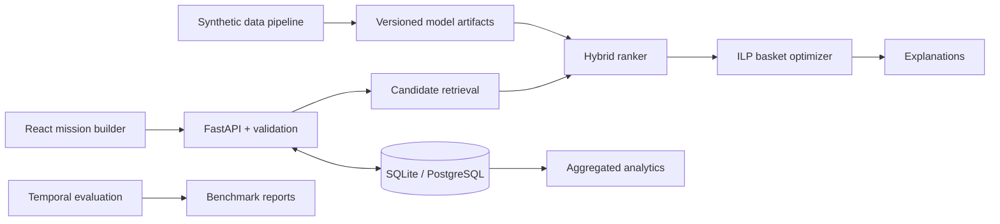

# RASA: Relevance-Aware Shopping Assistant

RASA is a product recommendation system built around **shopping missions, budget constraints, availability, and experience quality**. Instead of simply ranking popular products, RASA retrieves candidates, combines content, collaborative, and mission signals, then optimizes a basket that satisfies hard constraints.

> Portfolio project with an isolated single-merchant pilot mode. Committed products, users, merchants, prices, inventory, and interactions are **synthetic**; real merchant imports require permission and explicit labeling. This project is not an active marketplace, does not process payments, and makes no claims about real conversion or revenue impact.

## Single-merchant pilot

RASA focuses on college and boarding starter kits. The segment and merchant-as-payer model remain hypotheses. Start with the [pilot runbook](docs/pilot/README.md), [audit and priorities](docs/pilot/audit-and-priorities.md), [business validation pack](docs/pilot/business-validation.md), and [measurement contract](docs/pilot/measurement.md). The primary builder defaults to **English** with a persistent **English / Bahasa Indonesia** switch. It uses transparent `pilot-rules-v1` scoring for new merchant SKUs; the synthetic hybrid model remains available in the English technical demo. Unknown shipping is never treated as zero. A merchant summary is local text, not an order.

## What is included

- A skippable first-visit welcome and four-step spotlight tutorial, replayable through **How to use / Cara pakai**, with keyboard support and a mobile layout.
- An English-first bilingual bundle builder (English / Bahasa Indonesia) and an optional English technical mission builder with built-in scenarios and a rule-based parser that always requires confirmation.
- Global and category popularity, content-based TF-IDF, collaborative item similarity, hybrid ranking, and a cold-start fallback.
- ILP basket optimization with beam-search fallback. Budget, required categories, inventory, and merchant limits are revalidated before a result is returned.
- Explanations derived from the score components and constraints actually used.
- A FastAPI REST API, OpenAPI documentation, a SQLite/PostgreSQL-compatible schema, anonymous feedback events, and aggregated analytics.
- A responsive React frontend with accessible states and clearly labeled empty, error, infeasible, and static-fallback states.
- A reproducible synthetic dataset, temporal splits, data-quality gates, evaluation, ablation analysis, and a clearly labeled non-causal A/B simulation.
- Unit, integration, and data tests, linting, dependency auditing, GitHub Actions, and a multi-stage Docker image.

## Current benchmark

The synchronized summary at the end of this document is generated from evaluation.json. Older manually copied figures are no longer separate sources.

## Architecture



Training and evaluation are separated from inference. The container loads versioned, pre-trained artifacts, and API requests never trigger training.

## Quick start

### Docker

```bash
docker compose up --build
```

Open `http://localhost:8000`. API documentation is available at `http://localhost:8000/docs`, and the health endpoint is at `http://localhost:8000/health`.

### Local development

Requirements: Python 3.11+ and Node.js 22+.

```bash
python -m venv .venv
# Windows: .venv\Scripts\activate
# macOS/Linux: source .venv/bin/activate
pip install -e ".[dev]"
python scripts/seed_db.py
uvicorn apps.api.main:app --reload --port 8000
```

In another terminal:

```bash
cd frontend
npm ci
npm run dev
```

The frontend runs at `http://localhost:5173` and proxies `/api` to port 8000.

## Reproduce the ML pipeline

Demo-ready artifacts are committed so reviewers do not need to train the models. To reproduce the complete pipeline:

```bash
python scripts/generate_data.py
python scripts/train.py
python scripts/seed_db.py
```

The pipeline records the random seed, file checksums, dataset and model versions, weight configuration, validation selection, and test metrics. Hybrid weights are selected on the validation split; the test split is used only for final reporting.

Useful commands:

```bash
python scripts/evaluate.py
ruff check .
pytest --cov=rasa --cov-fail-under=50
cd frontend && npm audit && npm run lint && npm run build
```

## Core API

| Method | Endpoint | Purpose |
| --- | --- | --- |
| `GET` | `/health` | Model, catalog, and database readiness |
| `GET` | `/api/v1/scenarios` | Built-in demo scenarios |
| `GET` | `/api/v1/catalog/categories` | Catalog categories |
| `POST` | `/api/v1/missions/parse` | Mission draft from text; review required |
| `POST` | `/api/v1/missions` | Validate and store an anonymous mission |
| `POST` | `/api/v1/recommendations` | Ranking, optimization, and explanations |
| `POST` | `/api/v1/baskets/optimize` | Basket-focused response |
| `POST` | `/api/v1/feedback` | Anonymous feedback event |
| `GET` | `/api/v1/analytics/summary` | Aggregated analytics with sample warnings |
| `GET` | `/api/v1/experiments` | Experiment configuration and results |
| `GET` | `/api/v1/benchmark` | Machine-readable evaluation report |

Example request:

```bash
curl -X POST http://localhost:8000/api/v1/recommendations \
  -H "Content-Type: application/json" \
  -d '{
    "mission": {
      "goal": "Everyday campus essentials",
      "required_categories": ["bag", "stationery", "drinkware"],
      "optional_categories": ["organizer"],
      "max_budget": 250000,
      "max_merchants": 2
    },
    "preferences": {
      "style": ["minimalist"],
      "colors": ["black", "gray"],
      "brands": [],
      "minimum_rating": 4.2
    },
    "context": {
      "session_id": "demo-anon-001",
      "strategy": "hybrid_mission",
      "top_k": 10
    }
  }'
```

## Repository structure

```text
apps/api/                  deployment entry point
src/rasa/                  domain, ML, optimizer, services, API, and database
frontend/                  React mission builder and dashboard
configs/                   reproducible configuration and experiments
data/raw, data/processed/  synthetic dataset and temporal splits
artifacts/models/          lightweight versioned model artifacts
artifacts/reports/         machine-readable evaluation output
tests/                     unit, integration, and data tests
docs/                      PRD, cards, architecture, API, and reports
scripts/                   generation, training, evaluation, and seeding
```

## Documentation

- [Product requirements and traceability](docs/product-requirements.md)
- [Architecture](docs/architecture/system.md)
- [Dataset card](docs/dataset/dataset-card.md) and [data dictionary](docs/dataset/data-dictionary.md)
- [Model card](docs/model/model-card.md)
- [API guide](docs/api/README.md)
- [Deployment guide](docs/deployment.md)
- [Test report](docs/reports/test-report.md)
- [Problem validation notes](docs/problem-validation.md)
- [Release notes](docs/release-notes.md)

## Privacy, security, and limitations

- The UI does not request a name, phone number, address, email address, payment details, or an account.
- Feedback uses a random session ID and append-oriented events; the analytics endpoint returns aggregates only.
- Payload size, enums, ranges, timeouts, CORS, demo rate limits, and error responses are validated.
- The in-memory rate limiter is suitable for a single-process demo, not as a replacement for a distributed gateway.
- SQLite is suitable for the demo; use PostgreSQL for a multi-instance deployment.
- Web fonts have system fallbacks, and the frontend can show a labeled static example while the API wakes up.
- Synthetic data is insufficient for claims about real user preferences, marketplace fairness, conversion, or revenue.

## License

Code: [MIT](LICENSE). Synthetic dataset: CC BY 4.0, as recorded in the manifest. Third-party dependencies retain their respective licenses.

## Synchronized evaluation results

<!-- evaluation:begin -->
Single source: `artifacts/reports/evaluation.json`, run **2026-10-26T01:21:23Z**, dataset `rasa-synth-1.0.0` (synthetic), model `hybrid-v1`, seed 42.

| Measure | Result | Population |
| --- | ---: | --- |
| NDCG@10 EXP-006 | 0.0709 | 448 eligible users |
| Recall@10 EXP-006 | 0.1023 | same users |
| Feasibility EXP-007 | 99.17% | 120 synthetic missions |
| Required category coverage | 100.00% | feasible results only |
| Solver p95 | 132.64 ms | this run environment, not an SLA |

Generated by `python scripts/sync_evaluation_docs.py`; `--check` detects drift. See `docs/reports/benchmark-report.md` and `docs/model/evaluation-audit.md`. Offline results do not validate business impact or represent a live user experiment.
<!-- evaluation:end -->
